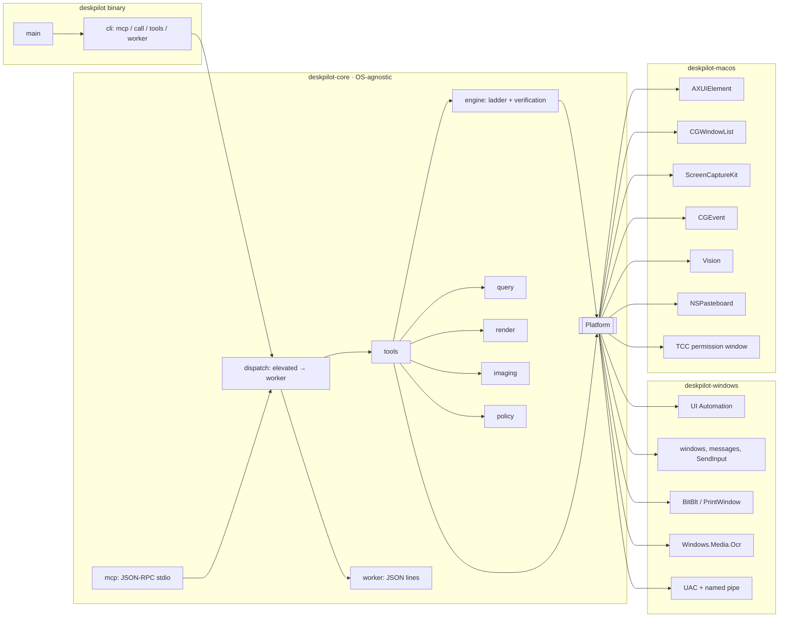
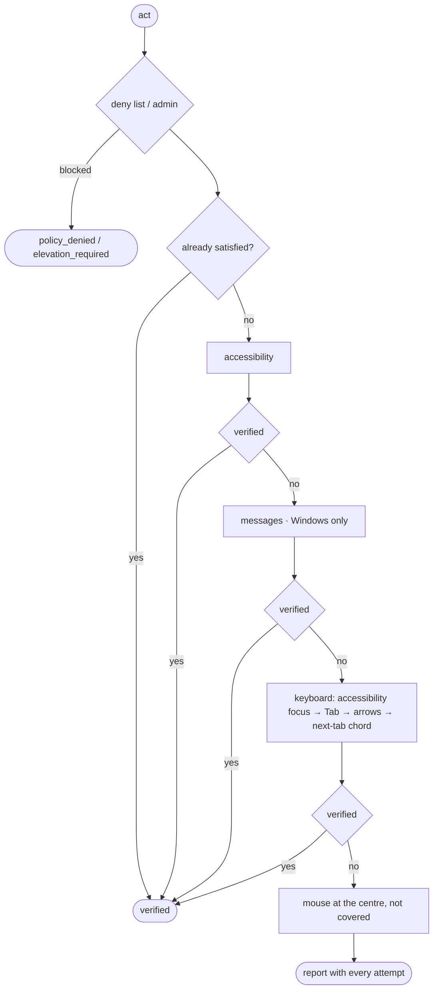

# Architecture



## Crates

| Crate | Contents |
|---|---|
| `deskpilot-core` | Model (`Rect`, `WindowInfo`, `ElementInfo`, `Role`…), keys, selectors and queries, the `Platform` trait, the `act` engine, policy, the tool catalogue with JSON schemas, the MCP server, the CLI and the worker protocol. Builds on any OS. |
| `deskpilot-windows` | `WindowsPlatform`: implements `Platform` with Win32, UIA, GDI, SendInput and WinRT OCR. |
| `deskpilot-macos` | `MacPlatform`: implements `Platform` with AXUIElement, CGWindowList, ScreenCaptureKit, CGEvent, Vision, NSPasteboard and NSWorkspace; the TCC permission window; `run` (AppKit on the main thread, program on a worker thread) and `disclaim_responsibility`. |
| `deskpilot` | Binary: picks the OS adapter and calls `deskpilot_core::cli::run`. |

## Adapter contract

`deskpilot_core::platform::Platform` only exposes native primitives; it neither picks strategies nor verifies anything:

- Platform: `info` (OS, administrator state, whether an elevated worker exists, OS privacy permissions), `shortcut(Shortcut)` (select all, open/close drop-down, next tab; `None` makes the keyboard step `unsupported`), `request_permissions(wait)`.
- Discovery: `monitors`, `windows`, `window`, `window_at`.
- Capture: `capture_screen`, `capture_window` (sets `occlusion_free`), `ocr` (bounds in image pixels; the `ocr` tool maps them to screen units).
- Accessibility: `tree` (with `max_depth`/`max_nodes`), `element`, `parent`, `focused_element`, `element_at`, `element_text`, `ax_action(AxOp)`.
- Messages: `message_action(MessageOp)`; returns `Unsupported` when the control has no reliable message.
- Real input: `foreground_window`, `send_keys`, `mouse`, `cursor_position`, `set_cursor_position`.
- Windows and apps: `window_op`, `launch`.
- Clipboard: `clipboard_get`, `clipboard_set`.
- Elevation: `spawn_elevated_worker`, `connect_worker` (bidirectional byte channel). The `elevate` tool and the `elevated` argument exist only when `info().can_elevate` (or the process is already the elevated worker).

References (`WindowId`, `ElementRef`) are opaque strings that the adapter encodes and re-resolves on every call, so they work across one-shot processes.

Coordinates are *screen units* of the virtual desktop: physical pixels on Windows (per-monitor DPI aware), points on macOS. A `Capture` carries `pixel_scale` (image pixels per screen unit: 1 on Windows, 2 on a Retina display); cropping, the screenshot mapping (`screen = origin + image_px / scale`, where `scale` includes `pixel_scale`) and OCR bounds honour it.

Error kinds the agent branches on: `elevation_required` (retry with `elevated: true`), `permission_required` (the user must grant an OS privacy permission; retrying does not help), `policy_denied`, `unsupported` (the ladder moves on), `not_found`, `timeout`.

## The `act` ladder



Verification per intent:

| Intent | Check |
|---|---|
| `select` | `selected == true` |
| `toggle` / `check` / `uncheck` | `toggle` changed or has the wanted value |
| `expand` / `collapse` | `expand` |
| `set_value` | `value` (or the document text) equals the request |
| `focus` | element has focus |
| `scroll_into_view` | `offscreen == false` |
| `press` and unexposed states | fingerprint: focus (only for strategies that do not move it themselves), visible windows and the window's tree without geometry |

An element that disappears after the attempt counts as a change (dialog closed, page or tab replaced). A state that is not reached yet is re-read for up to 500 ms before escalating, because some apps apply changes asynchronously and the next strategy would undo them.

After keyboard or mouse, the foreground goes back to the window that had it, except for `expand` (it would close the popup).

## Elevated worker (Windows)

1. The normal process creates `\\.\pipe\deskpilot-<pid>-<nanos>` (single instance, no remote clients).
2. It launches `deskpilot worker --endpoint <pipe> <policy flags>` with the `runas` verb (UAC prompt) and waits for the connection (120 s at most).
3. Protocol: one JSON line per request `{id, tool, args}` and one per response `{id, ok | error}`.
4. The worker exits when the pipe closes, i.e. when the MCP session or the CLI call ends.

## macOS

```mermaid
sequenceDiagram
  participant M as main thread (AppKit)
  participant P as program thread (cli::run)
  Note over M: disclaim_responsibility → re-exec as own TCC identity
  M->>P: spawn; M runs NSApplication (accessory, no Dock icon)
  P->>P: request_permissions(wait)
  alt everything granted
    P->>P: continue, no window
  else something missing
    P->>M: on_main: show permission window
    loop every second
      M->>M: AXIsProcessTrusted / Screen Recording probe → ✓ per row
    end
    M-->>P: all granted (window closes) or user closed it
  end
```

- Privacy (TCC), not administrator rights, gates accessibility, input and capture, so there is no elevated worker (`can_elevate: false`).
- TCC attributes permissions to the *responsible* process, normally the terminal or MCP client that launched deskpilot. `main` first re-executes the binary in place with the responsibility disclaimed (`posix_spawn` + `POSIX_SPAWN_SETEXEC`, same pid and stdio), so deskpilot is listed and granted as itself.
- Permission window: shown at start-up only when Accessibility or Screen Recording is missing. Each row has *Request* (system prompt: `AXIsProcessTrustedWithOptions` / `CGRequestScreenCaptureAccess`) and *Open Settings* (the exact Privacy pane), re-checks every second and shows a green check once granted; the window closes by itself when everything is granted. `call` waits for it; `mcp` does not block `initialize`, the window stays up next to the session and tools report `permission_required` meanwhile.
- `CGPreflightScreenCaptureAccess` keeps a `false` for the life of the process, so a live grant is detected through the window list (other apps' titles become visible). Capture APIs only see a fresh grant in a new process: a one-shot `call` re-executes itself after the grant; an MCP session gets a `permission_required` that says to restart the server.
- Screen units are points; `ElementRef` is `<CGWindowID>/<child index path>~<fingerprint>` (role, subrole, identifier/title). A reference whose fingerprint no longer matches is searched for again in the window and is never resolved to a different element.
- Window messages do not exist: `PlatformInfo::messages` is false, so the ladder skips that rung (accessibility → keyboard → mouse) and `info` lists only the three strategies. `shortcut`: select all is ⌘A, next tab is ⌃Tab, drop-downs have no universal key (`None`).
- Accessibility quirks handled by the adapter: a row's name is taken from its first titled cell; a cell is selected through its row; `focused` is only reported for the element the system says has focus (some apps answer `AXFocused` for every cell); tables with 100+ rows contribute only their `AXVisibleRows` to tree walks (the parent is marked truncated), so a long history does not cost thousands of IPC calls; sheets (save dialogs) resolve through their parent window. OCR enlarges images whose short side is under 400 px before Vision runs.
- Chromium browsers (Chrome, Edge, Brave, Helium…) and Electron apps (Slack, VS Code) build their page accessibility tree only for clients that ask. The first time deskpilot touches such a process it sets `AXManualAccessibility` (Electron) or `AXEnhancedUserInterface` (Chromium, detected by a `<Name> Framework.framework` with a renderer helper) and, for browsers, waits up to 2 s for the web area to appear. Native apps are never sent `AXEnhancedUserInterface` (it slows their window animations).
- Chromium quirks: `AXExpanded` is `false` on every web element (only real pop-ups/disclosures/rows report an expand state) and never changes on a `<select>`, so a pop-up counts as expanded while its app shows a pop-up menu window (layer 101) and the pop-up has focus. `<select>` ignores synthesized Unicode text, so the keyboard `set_value` of a closed drop-down types each character as its key (type-ahead). Text-pattern answers that are empty fall back to the subtree's accessible names in `read_text`.
