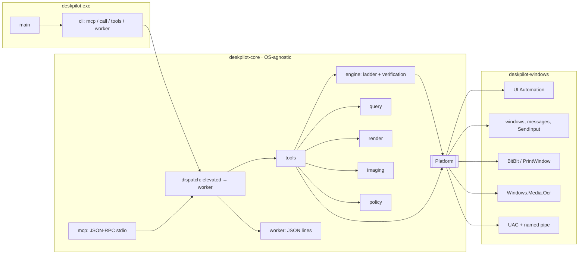
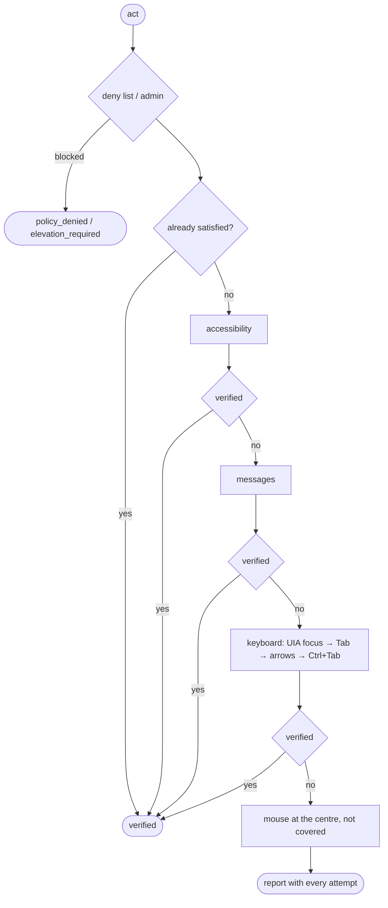

# Architecture

## Crates

| Crate | Contents |
|---|---|
| `deskpilot-core` | Model (`Rect`, `WindowInfo`, `ElementInfo`, `Role`…), keys, selectors and queries, the `Platform` trait, the `act` engine, policy, the tool catalogue with JSON schemas, the MCP server, the CLI and the worker protocol. Builds on any OS. |
| `deskpilot-windows` | `WindowsPlatform`: implements `Platform` with Win32, UIA, GDI, SendInput and WinRT OCR. |
| `deskpilot` | Binary: picks the OS adapter and calls `deskpilot_core::cli::run`. |

## Adapter contract

`deskpilot_core::platform::Platform` only exposes native primitives; it neither picks strategies nor verifies anything:

- Discovery: `monitors`, `windows`, `window`, `window_at`.
- Capture: `capture_screen`, `capture_window` (sets `occlusion_free`), `ocr` (bounds relative to the image).
- Accessibility: `tree` (with `max_depth`/`max_nodes`), `element`, `parent`, `focused_element`, `element_at`, `element_text`, `ax_action(AxOp)`.
- Messages: `message_action(MessageOp)`; returns `Unsupported` when the control has no reliable message.
- Real input: `foreground_window`, `send_keys`, `mouse`, `cursor_position`, `set_cursor_position`.
- Windows and apps: `window_op`, `launch`.
- Clipboard: `clipboard_get`, `clipboard_set`.
- Elevation: `spawn_elevated_worker`, `connect_worker` (bidirectional byte channel).

References (`WindowId`, `ElementRef`) are opaque strings that the adapter encodes and re-resolves on every call, so they work across one-shot processes.

## The `act` ladder

Verification per intent:

| Intent | Check |
|---|---|
| `select` | `selected == true` |
| `toggle` / `check` / `uncheck` | `toggle` changed or has the wanted value |
| `expand` / `collapse` | `expand` |
| `set_value` | `value` (or the document text) equals the request |
| `focus` | element has focus |
| `scroll_into_view` | `offscreen == false` |
| `press` and unexposed states | fingerprint: focus (only for strategies that do not move it themselves), visible windows and the window's tree without geometry |

After keyboard or mouse, the foreground goes back to the window that had it, except for `expand` (it would close the popup).

## Elevated worker

1. The normal process creates `\\.\pipe\deskpilot-<pid>-<nanos>` (single instance, no remote clients).
2. It launches `deskpilot worker --endpoint <pipe> <policy flags>` with the `runas` verb (UAC prompt) and waits for the connection (120 s at most).
3. Protocol: one JSON line per request `{id, tool, args}` and one per response `{id, ok | error}`.
4. The worker exits when the pipe closes, i.e. when the MCP session or the CLI call ends.

## Adding macOS

Create `deskpilot-macos` with a type that implements `Platform` (AXUIElement for accessibility, CGWindowList and ScreenCaptureKit for windows and capture, CGEvent for input, Vision for OCR, NSPasteboard for the clipboard). Map AX roles to `Role` and encode `ElementRef` so it can be resolved again. Select it in `crates/deskpilot/src/main.rs` with `#[cfg(target_os = "macos")]`. Window messages do not exist there: `message_action` returns `Unsupported` and the ladder moves on to the keyboard.
