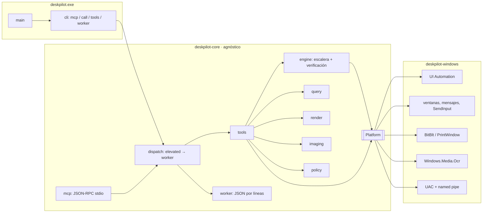
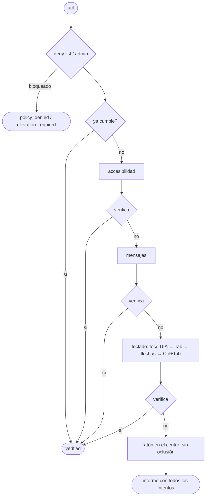

# Arquitectura

## Crates

| Crate | Contenido |
|---|---|
| `deskpilot-core` | Modelo (`Rect`, `WindowInfo`, `ElementInfo`, `Role`…), teclas, selectores y consultas, trait `Platform`, motor `act`, política, catálogo de herramientas con esquema JSON, servidor MCP, CLI y protocolo del worker. Compila en cualquier sistema. |
| `deskpilot-windows` | `WindowsPlatform`: implementa `Platform` con Win32, UIA, GDI, SendInput y WinRT OCR. |
| `deskpilot` | Binario: elige el adaptador del sistema y llama a `deskpilot_core::cli::run`. |

## Contrato del adaptador

`deskpilot_core::platform::Platform` solo expone primitivas nativas; no decide estrategias ni verifica nada:

- Descubrimiento: `monitors`, `windows`, `window`, `window_at`.
- Captura: `capture_screen`, `capture_window` (marca `occlusion_free`), `ocr` (límites relativos a la imagen).
- Accesibilidad: `tree` (con `max_depth`/`max_nodes`), `element`, `parent`, `focused_element`, `element_at`, `element_text`, `ax_action(AxOp)`.
- Mensajes: `message_action(MessageOp)`; devuelve `Unsupported` si el control no tiene un mensaje fiable.
- Entrada real: `foreground_window`, `send_keys`, `mouse`, `cursor_position`, `set_cursor_position`.
- Ventanas y apps: `window_op`, `launch`.
- Portapapeles: `clipboard_get`, `clipboard_set`.
- Elevación: `spawn_elevated_worker`, `connect_worker` (canal de bytes bidireccional).

Las referencias (`WindowId`, `ElementRef`) son cadenas opacas que el adaptador codifica y vuelve a resolver en cada llamada, para que funcionen con procesos de una sola ejecución.

## Escalera de `act`

Verificación por intención:

| Intención | Comprobación |
|---|---|
| `select` | `selected == true` |
| `toggle` / `check` / `uncheck` | cambio o valor de `toggle` |
| `expand` / `collapse` | `expand` |
| `set_value` | `value` (o texto del documento) igual al pedido |
| `focus` | elemento con foco |
| `scroll_into_view` | `offscreen == false` |
| `press` y estados no expuestos | huella: foco (solo en estrategias que no lo mueven ellas mismas), ventanas visibles y árbol de la ventana sin geometría |

Después del teclado o el ratón se devuelve el primer plano a la ventana que lo tenía, salvo en `expand` (cerraría el desplegable).

## Worker elevado

1. El proceso normal crea `\\.\pipe\deskpilot-<pid>-<nanos>` (instancia única, sin clientes remotos).
2. Lanza `deskpilot worker --endpoint <tubería> <flags de política>` con el verbo `runas` (aviso UAC) y espera la conexión (120 s como máximo).
3. Protocolo: una línea JSON por petición `{id, tool, args}` y otra por respuesta `{id, ok | error}`.
4. El worker termina cuando se cierra la tubería, es decir, cuando termina la sesión MCP o la llamada CLI.

## Añadir macOS

Crear `deskpilot-macos` con un tipo que implemente `Platform` (AXUIElement para accesibilidad, CGWindowList y ScreenCaptureKit para ventanas y capturas, CGEvent para entrada, Vision para OCR, NSPasteboard para el portapapeles). Asignar los roles AX a `Role` y codificar `ElementRef` de forma que se pueda volver a resolver. En `crates/deskpilot/src/main.rs`, seleccionarlo con `#[cfg(target_os = "macos")]`. Los mensajes de ventana no existen allí: `message_action` devuelve `Unsupported` y la escalera pasa al teclado.
